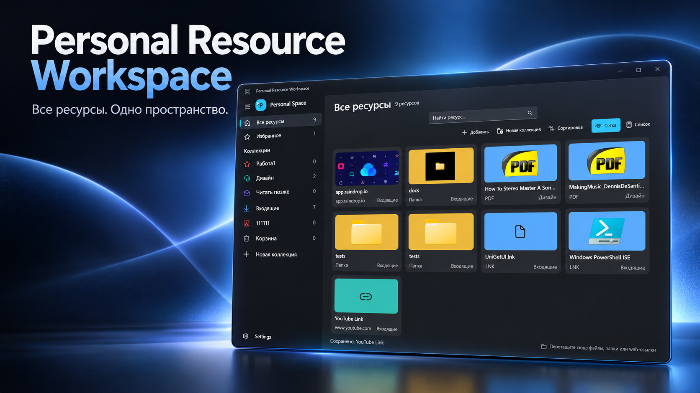

# Personal Resource Workspace

**Все ресурсы. Одно пространство.** Локальное приложение для Windows, в котором ссылки, файлы, папки, программы и заметки собраны в одном визуальном каталоге.

[English](docs/README.en.md) · [Сценарии пользователя](docs/user-stories.md) · [Запуск из исходников](docs/development.md) · [Устройство проекта](docs/architecture.md)

## Что уже работает

- **Всё под рукой:** добавляйте веб-ссылки, файлы, папки, приложения, текстовые и графические фрагменты, команды. Ресурсы сохраняются локально и доступны после перезапуска.
- **Узнаваемые карточки:** смотрите ресурсы в сетке с обложками, значками и превью либо переключайтесь на компактный список.
- **Удобная организация:** создавайте коллекции, задавайте им цвет и значок, отмечайте важное как избранное. Раздел «Все ресурсы» показывает содержимое целиком.
- **Быстрый доступ:** ищите по каталогу и сортируйте по названию или дате изменения. Открывайте ресурсы из карточки и редактируйте их через контекстное меню.
- **Простое добавление:** перетаскивайте файлы, папки и веб-ссылки в окно. При создании ресурса приложение может подставить содержимое буфера обмена.
- **Корзина:** случайно удалённый ресурс сначала попадает в корзину; её можно очистить отдельно.
- **Portable-данные:** новые сборки хранят базу и визуальные файлы в `content` рядом с приложением. В «Настройках» можно выбрать другой каталог; вид и сортировка сохраняются в БД.

Приложение находится в активной разработке. Скриншот показывает один из вариантов наполнения личного пространства; ваши данные и карточки будут другими.

## Попробовать

Скачайте [предварительную версию v0.1.1 для Windows x64](https://github.com/web2bear/PersonalResourceWorkspace/releases/tag/v0.1.1): распакуйте ZIP целиком и запустите `PersonalResourceWorkspace.App.exe`. Это переносимая версия без установщика и цифровой подписи. При желании проект можно [собрать из исходников](docs/development.md).

Версия v0.1.1 выпущена до реализации portable-хранения; описанное выше расположение `content` относится к текущему исходному коду и будущим сборкам.

## Идеи на будущее

Это направления развития, **не реализованные функции и не обещание сроков**:

- вложенные коллекции и более гибкое перемещение ресурсов между ними;
- ручной порядок карточек и дополнительные способы навигации;
- быстрый вызов пространства глобальной горячей клавишей;
- более удобная работа с текстовыми и графическими фрагментами;
- дополнительные настройки внешнего вида и сценариев запуска.

Предложения и сообщения об ошибках можно оставлять в [Issues](https://github.com/web2bear/PersonalResourceWorkspace/issues), если они включены для репозитория.

## О проекте

Проект развивается как личное локальное пространство для ресурсов: основные сценарии не требуют учётной записи или облачного сервиса. Текущие ограничения, сборка и устройство кода описаны отдельно: [разработка](docs/development.md), [архитектура](docs/architecture.md), [спецификация и долгосрочные цели](PROJECT.md).
